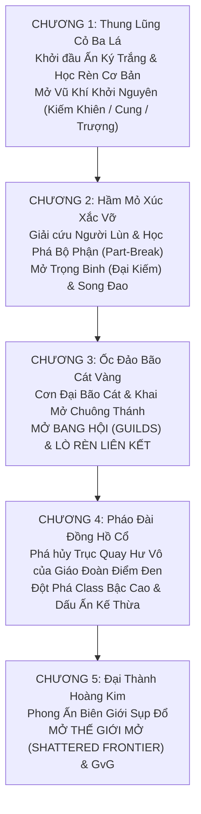

# ĐẶC TẢ TOÀN DIỆN (MASTER GDD v2.0): CỐT TRUYỆN, CƠ CHẾ CLASS THEO VŨ KHÍ, CÔNG THỨC TOÁN HỌC & DANH MỤC VẬT PHẨM – "LUCKY WORLD"

> [!NOTE]
> **Thông số Dự án & Định hướng Kỹ thuật (Cập nhật cho Unity 6.3 LTS — 3D Action RPG):**
> - **Tên dự án:** LUCKY WORLD
> - **Thể loại:** 3D Action RPG / Co-op Hunting / Open-World Guild Territorial Warfare (GvG)
> - **Engine & Ngôn ngữ:** Unity 6.3 LTS (URP) — C#
> - **Phong cách Nghệ thuật (Art Direction):** Semi-Realistic 3D PBR (Lấy cảm hứng từ *Monster Hunter* & *Dragon's Dogma* — tối ưu cho cơ chế chặt bộ phận **Part-Break** trên quái vật khổng lồ, chênh lệch độ cao 3D $\Delta Y$, và hiệu ứng VFX Graph Hoàng Kim/Cầu Vồng khi nổ xúc xắc `777` / `7777`).
> - **3 Trụ Cột Thiết Kế Cốt Lõi (Core Pillars):**
>   1. **Lộ trình Mở khóa Đan xen:** Mở Bang Hội & Lò Rèn Liên Kết ở **Chương 3**, mở toàn diện **Thế Giới Mở (Shattered Frontier) & Chiến Tranh Lãnh Thổ (GvG)** khi hoàn thành **Chương 5**.
>   2. **Cơ chế Vũ Khí Định Hình Class theo Cấp Bậc (Weapon-Bound Class & Mastery Rank):** Nhân vật chính không bị khóa cứng Class. Cầm vũ khí hệ nào sẽ kích hoạt bộ kỹ năng 3D của Class đó tương ứng với **Cấp Bậc Thông Thạo (Rank 1 → Rank 6)** hiện có của Class đó trên nhân vật, kết hợp tự do với Bộ Giáp và Xúc Xắc Bản Mệnh để custom lối chơi.
>   3. **Hệ thống Toán học (Damage 3D / LUCK Asymptotic RNG / Crafting FQS) & Danh mục Vật phẩm/Nguyên liệu/Công thức rèn** chi tiết xuyên suốt từ Chương 1 đến Endgame Thế Giới Mở.

---

## PHẦN 1: HOÀN THIỆN CỐT TRUYỆN, TRUYỀN THUYẾT "ẤN KÝ TRẮNG" & HỆ SINH THÁI QUÁI VẬT

### 1.1. Truyền Thuyết "Ấn Ký Trắng" (The Blank Die) & Cơ Chế Vũ Khí Định Hình Class
Trên lục địa **Fortuna** — thế giới hình thành từ sự kiện nổ vỡ của **Khối Đa Diện Vĩnh Hằng (Aethel-Die)** — mỗi người sinh ra đều mang trên mu bàn tay một **Ấn Ký Xúc Xắc (Fate-Mark)** cố định từ 1 đến 6 chấm, đồng thời khóa chặt linh hồn họ vào một loại binh khí duy nhất suốt đời.

Ngược lại, **Nhân Vật Chính ("Kẻ Vô Định" – The Unbound)** tỉnh dậy tại làng **Cloverbrook** với **Ấn Ký Trắng (Blank Die)** — một mặt xúc xắc phẳng lặng, trong suốt như pha lê nguyên thủy:
- **Cầm Vũ Khí Nào, Hóa Thân Class Đó (Weapon-Bound Identity):** Mỗi món vũ khí được đúc từ nguyên liệu của **Huyền Thú Nhiễm Vận (Fated Beasts)** đều lưu giữ **"Ký Ức Chiến Đấu" (Combat Echo)** của một hệ phái cổ đại. Khi nhân vật chính nắm lấy chuôi kiếm, giương cung hay nâng pháp trượng, *Ấn Ký Trắng* lập tức cộng hưởng và đổi màu, cho phép thi triển bộ kỹ năng và bộ chuyển động 3D (Animator Override / Combat Stance) của hệ vũ khí đó.
- **Ý nghĩa Lore của Cấp Bậc Thông Thạo (Class Rank / Mastery Tier):** Dù *Ấn Ký Trắng* cho phép cầm mọi loại vũ khí ngay lập tức, nhưng để đánh thức các tầng kỹ năng cao thâm, linh hồn nhân vật chính phải trải qua quá trình **Khắc Vết Tinh Thông (Mastery Engraving)** thông qua thực chiến, rèn luyện và vượt qua thử thách của các **Bậc Thầy Hệ Phái (Grandmasters)**. Khi đổi từ vũ khí này sang vũ khí khác, *Ấn Ký Trắng* tự động chuyển sang cấp bậc thông thạo tương ứng đã tu luyện của hệ vũ khí mới mà không làm mất tiến trình của các hệ cũ.

---

### 1.2. Chi Tiết 5 Chương Cốt Truyện Chính (Act-by-Act Narrative & Unlocks)

| Chương & Bối Cảnh 3D Semi-Realistic PBR | Mạch Nhiệm Vụ Chính & Biến Cố Cốt Truyện | NPC Bậc Thầy Vũ Khí & Tính Năng Mở Khóa |
| :--- | :--- | :--- |
| **Chương 1: Gió Nổi Thung Lũng Cỏ Ba Lá** *(Whispering Clover Vale — Lv.1–15)* | 1. **Khúc Dạo Đầu Bên Suối Vàng:** Thủy Triều Xui Xẻo của *Giáo Đoàn Điểm Đen* tràn qua biên giới. 2. **Lưỡi Kiếm Gãy & Lửa Lò Rèn:** Kiếm sắt thường gãy đôi trước quái vật nhiễm vận. **Lão Thợ Rèn Bromm** cứu người chơi, dạy cách săn nguyên liệu rừng để đúc vũ khí chứa *Luck Shard*. 3. **Đồng Điệu Đầu Tiên:** Tự tay rèn vũ khí đầu tiên và phát hiện bí mật của *Ấn Ký Trắng*. 4. **Trận Chiến Đền Thờ Gió:** Đánh bại Boss *Vua Slime Vương Miện Vỡ*. | - **Kiếm Sĩ Garrick:** Mở hệ **Kiếm & Khiên (Hộ Vệ)** và **Cung Tên (Xạ Thủ)**. - **Hiền Giả Elowen:** Mở hệ **Trượng Nguyên Tố (Pháp Sư)**. - *Tính năng:* Chiến đấu hành động 3D, Chuỗi săn quái (Hunt Chain), Lò Rèn Cơ Bản. |
| **Chương 2: Lửa Rèn Dưới Hầm Mỏ Xúc Xắc Vỡ** *(The Shattered Die Mines — Lv.15–30)* | 1. **Tiếng Vọng Từ Lòng Đất:** Cùng Bromm và nữ đạo chích **Lyra "Xúc Xắc Bạc"** tiến xuống khu mỏ cổ của Người Lùn. 2. **Kỹ Nghệ Phá Giáp:** Quái vật dưới mỏ có vỏ khoáng thạch siêu cứng. Học cách nhắm đánh (Lock-on / Free-aim 3D) vào bộ phận phát sáng để chặt đứt (**Part-Break**). 3. **Lò Luyện Nổi Giận:** Giải phóng thợ mỏ Người Lùn và hạ gục Boss *Golem Lò Luyện Ignis-7*. | - **Đại Tướng Thợ Mỏ Torbjorn:** Mở hệ **Trọng Binh (Đại Kiếm/Đại Rìu - Cuồng Chiến)**. - **Lyra "Xúc Xắc Bạc":** Mở hệ **Song Đao (Sát Thủ)**. - *Tính năng:* Cơ chế **Part-Break** theo Hitbox 3D, Khai thác mạch ẩn 3D, **Gieo Xúc Xắc Lò Rèn** & **Thanh Bảo Hiểm Fever**. |
| **Chương 3: Ốc Đảo Bão Cát Vàng & Ngọn Lửa Liên Minh** *(Mirage Bazaar of Dunes — Lv.30–45)* **[MỞ BANG HỘI]** | 1. **Hội Chợ Thợ Săn Vận:** Đặt chân tới ốc đảo giao thương sầm uất giữa sa mạc. 2. **Cơn Đại Bão Cát Hư Vô:** Tướng quân Giáo Đoàn kích hoạt Cổ Thú *Bọ Cạp Hoàng Kim Avarice*, tạo bão cát ăn mòn trang bị thường. Lò rèn cá nhân không đủ nhiệt nung chảy *Vàng Tinh Tú*. 3. **Khai Mở Hội Đồng Vận Mệnh:** Các chiến binh phải lập **Bang Hội**, cùng góp lửa tại **Lò Rèn Liên Kết** để đúc giáp kháng cát và tiêu diệt Avarice. | - **Bà Chúa Ốc Đảo Farah & Học Giả Al-zarim:** Mở hệ thứ 6 **Chuông Thánh & Xúc Xắc Ma Thuật (Sứ Giả Vận Mệnh)**. - *Tính năng:* Mở **Bang Hội (Guild Hall)**, **Lò Rèn Liên Kết**, **Ô Trang Bị thứ 8: Xúc Xắc Bản Mệnh (Soul Die)**, Phụ bản Co-op & Chợ Giao Dịch. |
| **Chương 4: Pháo Đài Đồng Hồ Cổ** *(The Clockwork Citadel — Lv.45–60)* | 1. **Bản Giao Hưởng Bánh Răng:** Tấn công pháo đài cơ khí trên đỉnh núi tuyết của Giáo Đoàn Điểm Đen. 2. **Thử Thách Bậc Thầy:** Vượt qua tàn ảnh Cổ Thần để đột phá **Class Rank IV (Bậc Thầy)**, mở khóa **Dấu Ấn Kế Thừa** (mang nội tại của vũ khí này sang vũ khí khác). 3. **Đập Tan Trục Quay Hư Vô:** Quyết chiến với thủ lĩnh **Hồng Y Malakor**. | - **Kiếm Thánh Mù Kaelen:** Giúp đột phá Bậc Thông Thạo cao cấp và mở khóa **Dấu Ấn Kế Thừa Cross-Class**. - *Tính năng:* **Can Thiệp Định Mệnh** (Đá Khóa Vận, Búa Gõ Lại), **Chiến Hồn Ký Ức** & Tập trận 5v5. |
| **Chương 5: Đại Thành Hoàng Kim & Vùng Biên Giới Vỡ Vụn** *(Aethelgard & The Grand Opening — Lv.60–70)* **[MỞ THẾ GIỚI MỞ & GvG]** | 1. **Vết Nứt Định Mệnh:** Trước khi gục ngã, Malakor làm nổ tung **Đại Phong Ấn Biên Giới**. 2. **Phòng Thủ Cổng Tinh Vân:** Hợp lực cùng **Thống Soái Vance** tiêu diệt Boss cuối cốt truyện *Kỵ Sĩ Phán Quyết Vô Diện*. 3. **Đại Khai Mở "Shattered Frontier":** Sương mù tan biến, lộ diện Lục Địa Trung Tâm chứa hàng ngàn mỏ thần kim và pháo đài cổ đại. Cánh cổng mở toang cho các Bang hội tiến ra tranh đoạt lãnh thổ! | - **Thống Soái Vance:** Trao *Ấn Tín Chinh Phạt*, mở giới hạn **Class Rank V & VI (Huyền Thoại & Thần Thoại)**. - *Tính năng:* Mở toàn diện **Thế Giới Mở 3D (Shattered Frontier)**, **Chiến Tranh Lãnh Thổ Bang Hội (GvG)** & Rèn Đồ Thần Thoại. |

---

## PHẦN 2: CƠ CHẾ CLASS THEO VŨ KHÍ, BẬC THÔNG THẠO & TỰ DO CUSTOM BUILD

### 2.1. Sáu Hệ Vũ Khí Định Hình Class (The 6 Weapon-Bound Classes)
Nhân vật không chọn Class cố định. Trang bị **Vũ Khí Chính (Main-Hand)** thuộc hệ nào sẽ lập tức kích hoạt Class, bộ Animation Rigging / Combat Stance 3D và bộ kỹ năng của hệ đó:

| Hệ Vũ Khí | Tên Class | Tầm Đánh & Loại DMG | Cơ Chế Chiến Đấu 3D Đặc Trưng | Vai Trò Cốt Truyện (PVE) & Bang Hội (GvG) |
| :--- | :--- | :--- | :--- | :--- |
| **1. Kiếm & Khiên** *(Sword & Shield)* | **Hộ Vệ Định Mệnh** *(Aegis Vanguard)* | Cận chiến (2.0m) Vật Lý | **Chặn Đòn Chuẩn Nhịp (Perfect Block):** Đỡ đòn đúng lúc chuyển hóa sát thương nhận vào thành sóng chấn động phản kích hình nón 3D phía trước. | **Main Tank / Frontline:** Hút thù hận Boss, giữ vòng Chiếm Cứ Điểm, dựng tường khiên 3D che đạn cho đồng đội. |
| **2. Song Đao** *(Dual Blades)* | **Ảnh Vũ Giả** *(Phantom Dancer)* | Cận chiến (2.5m) Vật Lý / Chuẩn | **Dấu Ấn Combo (1–6 Nút):** Đánh thường và lướt 3D tích điểm xúc xắc trên mục tiêu; kích nổ ở điểm 6 gây sát thương chuẩn & hồi chiêu. | **Burst DPS / Assassin:** Chặt bộ phận Tinh Anh (Part-Break) cực nhanh, móc dây/bám tường qua địa hình cao 3D ám sát tuyến sau địch. |
| **3. Trọng Binh** *(Greatsword / Great Axe)* | **Cuồng Chiến** *(Titan Breaker)* | Cận chiến rộng (3.5m) Vật Lý Nặng | **Tụ Lực Bá Thể (3 Nấc Charge):** Giữ chiêu gồng lực miễn nhiễm đẩy lùi, bổ nứt địa hình 3D và đập vỡ khiên chắn. | **Bruiser / Siege Breaker:** Phá giáp cứng của Boss, bổ sập cổng thành, hất văng đội hình khiên của địch. |
| **4. Cung / Nỏ Cơ Khí** *(Bow / Crossbow)* | **Xạ Thủ Chân Không** *(Horizon Ranger)* | Tầm xa (15.0m) Vật Lý Tầm Xa | **Cao Độ 3D (High-Ground Sniper):** Đứng trên địa hình cao hơn mục tiêu (trục $Y$) tăng mạnh tầm bắn, xuyên giáp và sát thương; hỗ trợ ngắm bắn vào điểm yếu trên lưng/đầu Boss. | **Sustained DPS / Marksman:** Bắn tỉa điểm yếu Boss trên cao, xả mưa tên từ tường thành xuống đội hình công thành. |
| **5. Trượng Nguyên Tố** *(Elemental Staff)* | **Pháp Sư Hỗn Mang** *(Flux Arcanist)* | Tầm trung-xa (12.0m) Phép Thuật | **Cộng Hưởng Địa Hình 3D:** Kết hợp Lửa + Băng + Sét trên mặt đất tạo vùng phản ứng vật lý/nguyên tố (Đốt thảm cỏ, Đóng băng mặt nước). | **AoE Control / Zone Denier:** Dọn quái bầy nhanh nhất, khóa chặt các cây cầu và điểm nghẽn trong GvG. |
| **6. Chuông Thánh & Xúc Xắc** *(Holy Bell & Mystic Dice)* | **Sứ Giả Vận Mệnh** *(Fateweaver Oracle)* | Tầm trung (10.0m) Phép Thuật / Hỗ Trợ | **Vòng Quay Phúc Lành:** Phát sóng âm thanh hình cầu 3D vừa hồi máu vừa tăng chỉ số **LUCK** và thao túng điểm xúc xắc của cả đội. | **Healer / Luck Amplifier:** Trụ cột trong Co-op Boss và GvG, giúp cả tiểu đội liên tục nổ *Lucky Hit* và hồi sinh chiến trường. |

---

### 2.2. Sáu Cấp Bậc Thông Thạo Class (Class Rank Progression I → VI)
- **Quy tắc khóa kỹ năng theo Bậc Class:** Cầm vũ khí hệ nào chỉ dùng được kỹ năng của hệ đó **đến đúng Cấp Bậc Thông Thạo (Class Rank) hiện có** của nhân vật ở hệ đó.
- Khi chiến đấu hoặc chế tạo vũ khí thuộc hệ nào, hệ đó nhận **Điểm Thông Thạo Vũ Khí (WXP)** để thăng từ **Rank 1 → Rank 6**:

| Cấp Bậc Class (Class Rank) | Cấp Thông Thạo (Mastery Lv.) | Hệ Số Sát Thương Kỹ Năng ($\text{Mod}_{\text{Rank}}$) | Mở Khóa Cây Kỹ Năng (5 Active + 3 Passive) & Quyền Năng Custom Build |
| :--- | :--- | :--- | :--- |
| **Rank 1: Tân Binh (Novice)** | Lv. 1 – 10 | $1.00\times$ | Mở **Đòn Đánh Thường 3 Nhịp**, **Skill 1 (Cơ bản)** và **Skill 2 (Cơ động/Đỡ đòn)**. Cho phép cầm Vũ khí Bậc 1. |
| **Rank 2: Tinh Nhuệ (Adept)** | Lv. 11 – 25 | $1.12\times$ | Mở **Skill 3 (Chiến thuật / Part-Break)** và **Passive 1 (Cơ chế đặc trưng hệ)**. Cho phép cầm Vũ khí Bậc 2. |
| **Rank 3: Chuyên Gia (Specialist)** | Lv. 26 – 40 | $1.25\times$ | Mở **Skill 4 (Tuyệt Kỹ Nhánh — Tự chọn Morph A đánh Boss hoặc Morph B đánh GvG)** và **Passive 2 (Tương tác LUCK)**. Cho phép cầm Vũ khí Bậc 3. |
| **Rank 4: Bậc Thầy (Master)** | Lv. 41 – 55 | $1.40\times$ | Mở **Đòn Đánh Nhịp 4**, **Passive 3**, cầm Vũ khí Bậc 4. **ĐẶC BIỆT: Mở khóa "Dấu Ấn Kế Thừa" (Cross-Class Passive)** — Cho phép mang **1 Nội Tại** của Class này gắn sang dùng khi cầm Vũ khí của Class khác! |
| **Rank 5: Huyền Thoại (Grandmaster)** | Lv. 56 – 70 | $1.60\times$ | Mở **Skill 5 (Tuyệt Kỹ Tối Thượng - Ultimate 3D Cinematic Camera)**, nâng hiệu lực *Dấu Ấn Kế Thừa* lên 100%. Cho phép cầm Vũ khí Bậc 5. |
| **Rank 6: Thần Thoại (Mythic Sovereign)** | Lv. 71 – 100 | $1.85\times$ | Mở **Thức Tỉnh Tuyệt Kỹ (Awakened Ultimate - Tự động gieo Xúc Xắc Định Mệnh khi tung chiêu cuối)**, cộng vĩnh viễn **+50 LUCK gốc**. Cho phép cầm Thần Khí Bậc 6. |

> [!TIP]
> **Sức mạnh của Tự Do Custom Build (Ví dụ thực tế):**
> - **Pháp Sư Cận Chiến Phản Đòn (Battle-Mage Tank):** Cầm *Trượng Nguyên Tố (Rank 5)* để dùng kỹ năng Hố Đen hút địch vào người + Mặc *Bộ Giáp Gai Thiết Giáp* (phản 35% sát thương cận chiến) + Gắn *Dấu Ấn Kế Thừa* từ hệ Kiếm Khiên (Rank 4) + Đeo *Xúc Xắc Huyết Ngọc Ma Cà Rồng* (hút máu diện rộng khi nổ 6 nút).
> - **Thánh Kỵ Sĩ Hồi Máu (Paladin Frontliner):** Cầm *Kiếm & Khiên (Rank 5)* đứng tuyến đầu + Mặc *Bộ Lễ Phục Tinh Hà* (-15% hồi chiêu) + Gắn *Dấu Ấn Kế Thừa* từ hệ Chuông Thánh (Rank 4: mỗi khi đỡ đòn thành công phát sóng hồi máu cho đồng đội xung quanh).

---

## PHẦN 3: HỆ THỐNG CÔNG THỨC TOÁN HỌC CỐT LÕI (DAMAGE, LUCK & CRAFTING FORMULAS)

### 3.1. Công Thức Tính Sát Thương Toàn Diện (Master Damage Formula)

$$\text{DMG}_{\text{Final}} = \left\lfloor \text{DMG}_{\text{Base}} \times \text{Mod}_{\text{Skill}} \times \text{Mod}_{\text{Def}} \times \text{Mod}_{\text{Crit}} \times \text{Mod}_{\text{Lucky}} \times \text{Mod}_{\text{3D}} \times \text{Mod}_{\text{Elem}} \right\rfloor + \text{DMG}_{\text{True}}$$

1. **Sát Thương Cơ Bản ($\text{DMG}_{\text{Base}}$):**
   $$\text{DMG}_{\text{Base}} = \left( \text{ATK}_{\text{Char}} + \text{ATK}_{\text{Weapon}} \right) \times \left( 1 + \sum \text{\%ATK}_{\text{Bonus}} \right) + \text{Flat}_{\text{ATK}}$$
2. **Hệ Số Kỹ Năng & Bậc Thông Thạo Class ($\text{Mod}_{\text{Skill}}$):**
   $$\text{Mod}_{\text{Skill}} = \text{Skill\%} \times \text{Mod}_{\text{Rank}} \times \left( 1 + \text{SkillDMG\%}_{\text{Gear}} \right)$$
   *(Trong đó $\text{Mod}_{\text{Rank}} \in [1.00, 1.85]$ theo bảng Class Rank ở mục 2.2).*
3. **Hệ Số Giảm Trừ Giáp / Kháng Phép Tiệm Cận ($\text{Mod}_{\text{Def}}$):**
   $$\text{DEF}_{\text{Eff}} = \max\left(0,\; \text{DEF}_{\text{Target}} \times (1 - \text{Pen\%}) - \text{Pen}_{\text{Flat}}\right)$$
   $$\text{Mod}_{\text{Def}} = 1 - \frac{\text{DEF}_{\text{Eff}}}{\text{DEF}_{\text{Eff}} + 400 + 25 \times Lv_{\text{Atk}}}$$
   *(Đảm bảo ở mọi cấp độ, khi $\text{DEF}_{\text{Eff}} = 400 + 25 \times Lv_{\text{Atk}}$ thì giảm đúng 50% sát thương, không bao giờ xảy ra lỗi miễn nhiễm 100% sát thương).*
4. **Hệ Số Chí Mạng ($\text{Mod}_{\text{Crit}}$):**
   $$\text{Mod}_{\text{Crit}} = \max\left(1.25,\; \text{CritDMG}_{\text{Atk}} - \text{CritRes}_{\text{Target}}\right) \quad (\text{nếu Crit, ngược lại } = 1.00)$$
5. **Hệ Số Không Gian 3D Cao Độ & Đánh Sau Lưng ($\text{Mod}_{\text{3D}}$):**
   Trong hệ tọa độ 3D của Unity (trục đứng là $Y$), với chênh lệch độ cao $\Delta Y = Y_{\text{Atk}} - Y_{\text{Target}}$ (mét) và góc hướng đánh vào phía sau lưng mục tiêu ($\text{Dot}(\vec{F}_{\text{Target}}, \vec{D}_{\text{Hit}}) > 0.5$, tức góc lệch sau lưng $< 60^\circ$):
   $$\text{Mod}_{\text{3D}} = \left( 1 + \text{Clamp}\left(\frac{\Delta Y}{10},\; -0.15,\; +0.20\right) \right) \times \text{Mod}_{\text{Backstab}}$$
   *(Đứng trên tường thành/vách đá cao hơn $\ge 2\text{m}$ nhận **+20% sát thương**; đánh từ phía sau lưng nhận $\text{Mod}_{\text{Backstab}} = 1.15$).*

---

### 3.2. Công Thức Toàn Diện Của Chỉ Số LUCK (Vận May)

Gọi $L$ là tổng chỉ số **LUCK** của nhân vật. Hàm chuẩn hóa tiệm cận $\mathcal{F}(L)$ với hằng số cân bằng $K_{\text{Luck}} = 600$ được định nghĩa là:
$$\mathcal{F}(L) = \frac{L}{L + 600}$$
*(Ở đầu game $L=150 \Rightarrow \mathcal{F}(L)=0.20$; giữa game $L=600 \Rightarrow \mathcal{F}(L)=0.50$; cuối game $L=1800 \Rightarrow \mathcal{F}(L)=0.75$).*

#### 1. Xác Suất & 3 Bậc Bùng Nổ Sát Thương "Lucky Hit" (`777` & `7777`)
- **Xác suất nổ Lucky Hit trên mỗi đòn đánh ($P_{\text{LuckyHit}}$):**
  $$P_{\text{LuckyHit}} = \min\left(0.65,\; \left(0.05 + 0.45 \times \frac{L}{L + 600}\right) \times \text{LHC}_{\text{Skill}} + \text{Bonus}_{\text{LuckyRate}}\right)$$
- **Khi đòn đánh nổ Lucky Hit, hệ thống phân thành 3 Bậc Bùng Nổ:**

| Bậc Lucky Hit | Tỷ Lệ Phân Bổ | Hệ Số Nhân $\text{Mod}_{\text{Lucky}}$ | Sát Thương Chuẩn Cộng Thêm ($\text{DMG}_{\text{True}}$) | Hiển Thị Trên Màn Hình 3D (World-Space UI & VFX Graph) |
| :--- | :--- | :--- | :--- | :--- |
| **Bậc 1: Lucky Strike (Vận Đỏ)** | $80\%$ | $1.35 + 0.30 \times \mathcal{F}(L)$ | $+0$ | Số sát thương nảy lên kèm biểu tượng **Cỏ 4 Lá Vàng**. |
| **Bậc 2: Jackpot `777` (Tam Thất)** | $17\%$ | $1.77\times$ | $+\mathbf{777} \times \left(1 + \frac{Lv_{\text{Atk}}}{20}\right)$ | Nảy số **`777` (hoặc bội số)** màu Cam Rực kèm tiếng chuông Jackpot. |
| **Bậc 3: Miracle `7777` (Thiên Mệnh)** | $3\% + 4\% \times \mathcal{F}(L)$ | $2.77\times$ | $+\mathbf{7,777} \times \left(1 + \frac{Lv_{\text{Atk}}}{20}\right)$ | Tia sét Cầu Vồng 3D giáng xuống, nảy số **`7777` (hoặc bội số)** xuyên mọi khiên chắn! |

*(Trong PvP/GvG, lượng $\text{DMG}_{\text{True}}$ cộng thêm của `777` và `7777` được nhân hệ số cân bằng $0.25$ để tránh sốc chết 1-hit nhưng vẫn giữ nguyên hiệu ứng thị giác hoàng kim).*

#### 2. Hệ Số Khuếch Đại Nội Tại Trang Bị (Lucky Proc Multiplier)
Mọi dòng nội tại có xác suất gốc $P_{\text{Base}}$ trên vũ khí/giáp đều tăng tỷ lệ kích hoạt theo **LUCK**:
$$P_{\text{ActualProc}} = \min\left(0.80,\; P_{\text{Base}} \times \left(1 + 1.50 \times \frac{L}{L + 600}\right)\right)$$

#### 3. Xác Suất Né Tránh Thần Kỳ (Lucky Dodge) & Hồi Chiêu Nội Tại (ICD)
$$P_{\text{LuckyDodge}} = 0.03 + 0.22 \times \frac{L}{L + 600} \quad \text{và} \quad \text{ICD}_{\text{Dodge}} = \max\left(6.0\text{s},\; 15.0\text{s} - 6.0\text{s} \times \frac{L}{L + 600}\right)$$
*(Khi máu dưới 15%, $P_{\text{LuckyDodge}}$ được nhân đôi thành **Miracle Survival** giúp lật kèo ngoạn mục).*

#### 4. Công Thức Tỷ Lệ Rơi Nguyên Liệu (Drop Rate & Part-Break Bonus)
$$P_{\text{Drop}} = \min\left(P_{\text{Cap}},\; P_{\text{BaseDrop}} \times \left(1 + 1.20 \times \frac{L_{\text{PartyAvg}}}{L_{\text{PartyAvg}} + 600} + \min(0.50, 0.01 \times N_{\text{HuntChain}})\right) \times \text{Mod}_{\text{PartBreak}} \times \text{Mod}_{\text{Territory}}\right)$$
- Phá vỡ 1 bộ phận Tinh Anh/Boss ($\text{Mod}_{\text{PartBreak}} = 1.50$); phá vỡ toàn bộ bộ phận ($\text{Mod}_{\text{PartBreak}} = \mathbf{2.00}$ — nhân đôi tỷ lệ rớt nguyên liệu hiếm!).
- Săn trong hầm ngục Lãnh thổ Bang hội chiếm đóng ($\text{Mod}_{\text{Territory}} = 1.25$).

#### 5. Công Thức Điểm Chất Lượng Lò Rèn ($\text{FQS}$) & Thanh Bảo Hiểm Fever
Khi gieo 3 viên xúc xắc 6 mặt vật lý 3D ($D_1, D_2, D_3 \in \{1..6\}$) trên đe rèn, gọi hệ số dịch chuyển vận mệnh là $\lambda = 0.50 \times \frac{L}{L+600} + C_{\text{Cat}} + B_{\text{Guild}}$:
$$\text{FQS} = \left\lfloor \frac{\sum_{i=1}^{3} D_i}{18} \times 70 + 30 \times \min(1.0,\; \lambda) + \text{GuildAnvil}_{\text{Assist}} \right\rfloor$$
- $\text{FQS} < 75$: **Rèn Tiêu Chuẩn** (Chỉ số $85\%–105\%$, cộng $+20 \times (1 + 0.5\mathcal{F}(L))$ điểm vào **Thanh Bảo Hiểm Fever**).
- $\text{FQS} \in [75, 94]$ hoặc Sảnh $(4,5,6)$: **Đại Thành Công (Lucky Surge!)** (+1 Bậc Phẩm chất, chỉ số $105\%–120\%$, mở thêm 1 dòng phụ).
- $\text{FQS} \ge 95$ hoặc Bộ Ba $(6,6,6)$: **Kiệt Tác Định Mệnh (Miracle Craft!)** (Đột biến lên bậc Thần Thoại/Định Mệnh, chỉ số kịch trần **$130\%$**, mở **Nội tại Đột biến Cầu Vồng** và có $25\%$ nổ **Rèn 1 Ra 2 Món**!).

---

## PHẦN 4: MASTER CATALOG – DANH MỤC NGUYÊN LIỆU, VŨ KHÍ, GIÁP TRỤ & VẬT PHẨM

### 4.1. Danh Mục Nguyên Liệu Săn Bắn & Thu Thập (Chương 1 → Chương 5 & Thế Giới Mở)

| Vùng Đất / Giai Đoạn | Nhóm 1: Quái Thường (Common Drops) | Nhóm 2: Quái Tinh Anh (Part-Break Drops) | Nhóm 3: Lõi Boss & Chiến Hồn (Boss Drops) | Nhóm 4: Xúc Tác Môi Trường 3D (Catalysts) |
| :--- | :--- | :--- | :--- | :--- |
| **Chương 1: Thung Lũng Cỏ Ba Lá** *(Lv. 1 – 15 / Bậc 1)* | - **Sắt Vụn Rỉ Sét** *(Slime)* - **Da Sói Thảo Nguyên** *(Sói Gió)* - **Gỗ Phong Khô** *(Ma Cây)* | - **Nanh Sói Đầu Đàn** *(Chém hàm Sói Tinh Anh)* - **Mảnh Giáp Đồng Xanh** *(Đập vai Gấu Giáp)* - **Nhánh Sừng Khúc Xạ** *(Bắn sừng Hươu Pha Lê)* | - **Lõi Hoàng Kim Nhầy** *(Vua Slime)* - **Chiến Hồn: Kỵ Sĩ Lạc Lối** *(+15% Chặn đòn tiểu đội)* | - **Sương Sớm Thung Lũng** *(Thu thập lúc Bình minh)* - **Đá Lửa Hang Gió** *(Mạch quặng phát sáng)* |
| **Chương 2: Hầm Mỏ Xúc Xắc Vỡ** *(Lv. 15 – 30 / Bậc 2)* | - **Tơ Nhện Độc Dạ Quang** - **Vảy Thằn Lằn Đầm/Mỏ** - **Gỗ Đước Ngấm Ma Khí** | - **Túi Nọc Độc Nguyên Vẹn** *(Đánh bụng Nhện)* - **Đuôi Đá Nóng Chảy** *(Chặt đuôi Thằn Lằn Lửa)* - **Sừng Hươu Tinh Linh** *(Phá sừng)* | - **Tim Lò Luyện Ignis-7** - **Chiến Hồn: Xạ Thủ Hầm Ngầm** *(Đòn thứ 5 nổ sát thương lan)* | - **Đom Đóm Hư Không** *(Xuất hiện ban đêm)* - **Nhựa Cây Cổ Thụ** *(Thu hoạch khi mưa)* |
| **Chương 3: Ốc Đảo Bão Cát Vàng** *(Lv. 30 – 45 / Bậc 3)* | - **Quặng Thép Đỏ Nung** - **Than Đá Hỏa Ngục** - **Da Kỳ Nhông Lửa** | - **Búa Đập Thợ Rèn Điên** *(Đánh rơi vũ khí)* - **Mắt Đá Magma** *(Đập ngực Golem)* - **Lông Vũ Vàng Tinh Tú** *(Chặt cánh Nhân Sư)* | - **Tinh Thể Tham Lam Avarice** - **Chiến Hồn: Đại Tướng Sa Mạc** *(Gọi Tường Lửa chặn đường)* | - **Tro Tàn Phun Trào** *(Mạch cát nóng)* - **Nước Ngầm Ốc Đảo** *(Mạch ngầm tầng đáy)* |
| **Chương 4: Pháo Đài Đồng Hồ Cổ** *(Lv. 45 – 60 / Bậc 4)* | - **Tinh Thể Băng Vĩnh Cửu** - **Lông Vũ Điểu Nhân** - **Quặng Bạc Ánh Trăng** | - **Móng Vuốt Phong Băng** *(Chặt cánh Quái Điểu)* - **Lõi Khiên Băng Giá** *(Phá khiên Kỵ Sĩ Máy)* | - **Mảnh Đa Diện Đen Malakor** - **Chiến Hồn: Pháp Sư Băng Hà** *(Đóng băng diện rộng 2s)* | - **Hoa Tuyết Sáu Cánh** *(Nở giữa Bão Tuyết)* - **Tia Sét Đóng Băng** *(Cột thu lôi đỉnh tháp)* |
| **Chương 5: Đại Thành Hoàng Kim** *(Lv. 60 – 70 / Bậc 5)* | - **Bụi Sao Rơi (Stardust)** - **Mảnh Vỡ Thánh Quang** - **Vải Lụa Thời Gian** | - **Cánh Thiên Thần Sa Ngã** *(Phá cánh Hộ Vệ)* - **Mảnh Xúc Xắc Hỗn Mang** *(Phá lõi Hư Không)* | - **Trái Tim Thần Vận Mệnh** - **Chiến Hồn: Vua Không Ngai** *(Ép toàn bộ Xúc Xắc ra 6 nút trong 5s)* | - **Giọt Lệ Thời Gian** *(Khe nứt không gian)* - **Ánh Hào Quang Nhật Thực** *(Sự kiện Nhật thực)* |
| **Thế Giới Mở: Vòng 1 → Vòng 3** *(Shattered Frontier / GvG)* | - **Quặng Titan Biên Cảnh** *(Vòng 1)* - **Quặng Huyết Tinh** *(Vòng 2)* - **Kim Loại Orichalcum** & **Sợi Tơ Định Mệnh** *(Vòng 3)* | - **Sừng Tê Giác Thiết Giáp** *(Vòng 1)* - **Gân Rồng Đàn Hồi** *(Chặt đuôi Rồng Vòng 2)* - **Mảnh Giáp Thần Cổ Đại** *(Vòng 3)* | - **Lõi Thú Hoang Khổng Lồ** *(Boss V1)* - **Trái Tim Cổ Long Ouroboros** *(Boss V2)* - **Viên Đá Vận Mệnh Khởi Nguyên** *(Độc quyền Kinh Đô Vòng 3)* | - **Đá Tinh Luyện Bang Hội** *(Mỏ Vòng 1)* - **Tinh Hoa Lò Rèn Cổ Đại** *(Lò Rèn Pháo Đài Vòng 2 & 3)* |

---

### 4.2. Danh Mục 36 Vũ Khí Theo 6 Hệ Class & Công Thức Chế Tạo (Bậc 1 → Bậc 6)

#### A. Hệ HỘ VỆ (Kiếm & Khiên) & Hệ SÁT THỦ (Song Đao)
| Bậc & Yêu Cầu Class Rank | Vũ Khí Hệ HỘ VỆ (Kiếm & Khiên) + Kỹ Năng & Đột Biến | Vũ Khí Hệ SÁT THỦ (Song Đao) + Kỹ Năng & Đột Biến | Công Thức Chế Tạo Chuẩn (Recipe) |
| :--- | :--- | :--- | :--- |
| **Bậc 1 (Rank 1)** *Chương 1* | **Kiếm Khiên Sắt Rỉ** *Skill:* Đập Khiên (Choáng 1s) *Đột biến:* 10% phản sát thương vật lý. | **Song Đoản Đao Nanh Sói** *Skill:* Cắt Chéo (Chảy máu) *Đột biến:* +15% tốc chạy ngoài giao tranh. | 5x Nguyên liệu Thường C1 + 2x Nguyên liệu Tinh Anh C1 *(Mảnh Giáp Đồng / Nanh Sói)* |
| **Bậc 2 (Rank 2)** *Chương 2* | **Bộ Khiên Vảy Hầm Ngầm** *Skill:* Vùng Chắn Độc (-20% DMG nhận) *Đột biến:* Hồi 2% HP mỗi khi đỡ đòn. | **Song Đao Nọc Nhện Đêm** *Skill:* Bước Chân Bóng Tối (Áp sát sau lưng) *Đột biến:* Đánh sau lưng 100% Chí mạng. | 8x Nguyên liệu Thường C2 + 3x Nguyên liệu Tinh Anh C2 + 1x Xúc tác C2 *(Nhựa Cây / Đom Đóm)* |
| **Bậc 3 (Rank 3)** *Chương 3* | **Khiên Pháo Đài Dung Nham** *Skill:* Xung Kích Lửa (Đẩy lùi hàng ngang) *Đột biến:* Khiên nổ lửa khi bị đánh vỡ. | **Song Nhẫn Hỏa Ngục** *Skill:* Vũ Điệu Lửa Xoay (Chém liên hoàn) *Đột biến:* +35% sát thương Part-Break. | 10x Quặng Thép Đỏ Nung + 2x Tinh Anh C3 + 1x **Tinh Thể Avarice** + 1x Xúc tác C3 |
| **Bậc 4 (Rank 4)** *Chương 4* | **Thánh Khiên Băng Vĩnh Cửu** *Skill:* Pháo Đài Băng (Tường băng chặn đạn 4s) *Đột biến:* Kẻ đánh vào khiên giảm 30% tốc đánh. | **Song Đao Phong Tuyết** *Skill:* Ảo Ảnh Băng (Phân thân nổ & Tàng hình 3s) *Đột biến:* Hạ địch reset hồi chiêu Lướt. | 12x Nguyên liệu Thường C4 + 3x Tinh Anh C4 + 1x **Mảnh Đa Diện Malakor** + 1x Hoa Tuyết |
| **Bậc 5 (Rank 5)** *Chương 5* | **Khiên Phán Quyết Định Mệnh** *Skill:* Vòng Tròn Bất Tử (Bất tử nhóm 2.5s) *Đột biến:* Đỡ đòn +1 nút Xúc Xắc Bản Mệnh. | **Song Đao Cắt Đứt Tơ Trời** *Skill:* Nhát Chém Không Gian (Khóa phép 2s) *Đột biến:* 6% gây sát thương chuẩn = 10% HP. | **1x Vũ khí Bậc 4 (Phôi gốc)** + 6x Nguyên liệu C5 + 2x Tinh Anh C5 + 1x **Trái Tim Thần Vận Mệnh** |
| **Bậc 6 (Rank 6)** *Thế Giới Mở V3* | **Thần Khiên Aegis Hỗn Mang** *Skill GvG:* **Thành Lũy Vạn Quân** (Khiên ánh sáng khổng lồ che cho 20 đồng đội công thành). | **Thần Đao Dạ Đế Hư Không** *Skill GvG:* **Ám Sát Chỉ Huy** (Nhảy qua tường thành, cô lập Tướng địch trong 3s). | **1x Vũ khí Bậc 5 (Phôi gốc)** + 15x Kim Loại Orichalcum + 5x Tinh Anh V3 + 1x **Viên Đá Vận Mệnh Khởi Nguyên** |

#### B. Hệ CUỒNG CHIẾN (Trọng Binh) & Hệ PHÁP SƯ (Trượng Nguyên Tố)
| Bậc & Yêu Cầu Class Rank | Vũ Khí Hệ CUỒNG CHIẾN (Trọng Kiếm/Rìu) | Vũ Khí Hệ PHÁP SƯ (Trượng Nguyên Tố) | Công Thức Chế Tạo Chuẩn (Recipe) |
| :--- | :--- | :--- | :--- |
| **Bậc 1 (Rank 1)** | **Trọng Kiếm Đá Cuội** *Skill:* Bổ Núi (Hất tung) \| *Đột biến:* Máu thấp tăng tới +25% DMG. | **Trượng Gỗ Phong Đá Lửa** *Skill:* Cầu Lửa Đốt Cỏ \| *Đột biến:* +15% tốc hồi Mana. | 6x Nguyên liệu Thường C1 + 1x Lõi Hoàng Kim Nhầy + 2x Đá Lửa Hang Gió |
| **Bậc 2 (Rank 2)** | **Đại Đao Gỗ Đước Cổ Thụ** *Skill:* Quét Ngang Hút Địch \| *Đột biến:* Hút 8% máu từ sát thương. | **Trượng Tinh Linh Quang Ảnh** *Skill:* Đầm Lầy Trói Buộc \| *Đột biến:* Nổ thêm 1 lần vào ban đêm. | 8x Gỗ Đước Ngấm Ma Khí + 2x Sừng Hươu Tinh Linh + 1x Tim Lò Luyện Ignis-7 |
| **Bậc 3 (Rank 3)** | **Đại Cự Kiếm Nham Thạch** *Skill:* Cơn Thịnh Nộ Núi Lửa (Gồng 3 nấc) \| *Đột biến:* Đập vỡ 100% Khiên mục tiêu. | **Trượng Lõi Phản Ứng Nhiệt** *Skill:* 3 Cột Lửa Địa Ngục \| *Đột biến:* Đốt mặt đất gây DMG chuẩn 5s. | 10x Quặng Thép Đỏ / Than Đá + 3x Tinh Anh C3 + 1x Tinh Thể Avarice |
| **Bậc 4 (Rank 4)** | **Cự Rìu Sấm Sét Tháp Mây** *Skill:* Cuồng Phong Lôi Đình \| *Đột biến:* Miễn nhiễm làm chậm/đóng băng khi xoay. | **Quyền Trượng Bão Tuyết** *Skill:* Mưa Sao Băng Giá \| *Đột biến:* Tạo khiên băng bằng 20% Mana. | 12x Nguyên liệu Thường C4 + 3x Tinh Anh C4 + 1x Mảnh Đa Diện Malakor + 2x Xúc tác C4 |
| **Bậc 5 (Rank 5)** | **Thần Cự Kiếm Phán Phạt** *Skill:* Thiên Thạch Trảm \| *Đột biến:* Bất tử 2s khi máu tụt về 1 HP. | **Quyền Trượng Tinh Hà Hỗn Mang** *Skill:* Hố Đen Trọng Lực \| *Đột biến:* Mỗi nút Xúc Xắc +5% bán kính chiêu. | **1x Vũ khí Bậc 4 (Phôi gốc)** + 8x Mảnh Vỡ Thánh Quang / Bụi Sao + 1x Trái Tim Thần Vận Mệnh |
| **Bậc 6 (Rank 6)** | **Thái Cổ Cự Kiếm Khai Thiên** *Skill GvG:* **Chẻ Đôi Chiến Trường** (Sóng chấn động dài 20m hất văng tiền tuyến địch). | **Thần Trượng Thiên Tai Vạn Tượng** *Skill GvG:* **Biến Đổi Thời Tiết** (Đổi thời tiết bản đồ GvG thành Bão Sét/Mưa Lửa 15s). | **1x Vũ khí Bậc 5 (Phôi gốc)** + 15x Orichalcum / Tơ Định Mệnh + 3x Tinh Hoa Lò Rèn Cổ Đại + 1x Viên Đá Khởi Nguyên |

#### C. Hệ XẠ THỦ (Cung / Nỏ) & Hệ SỨ GIẢ VẬN MỆNH (Chuông Thánh & Xúc Xắc)
| Bậc & Yêu Cầu Class Rank | Vũ Khí Hệ XẠ THỦ (Cung / Nỏ Cơ Khí) | Vũ Khí Hệ SỨ GIẢ VẬN MỆNH (Chuông Thánh) | Công Thức Chế Tạo Chuẩn (Recipe) |
| :--- | :--- | :--- | :--- |
| **Bậc 1 (Rank 1)** | **Cung Săn Gân Sói** *Skill:* Mũi Tên Xuyên Phá \| *Đột biến:* Bắn càng xa DMG càng tăng. | **Chuông Đồng Gió Sớm** *Skill:* Tiếng Chuông Thanh Tẩy (Hồi máu & Xóa debuff) \| *Đột biến:* +10% tốc đánh cho đồng đội. | 5x Nguyên liệu Thường C1 + 2x Tinh Anh C1 + 1x Sương Sớm Thung Lũng |
| **Bậc 2 (Rank 2)** | **Cung Tơ Nhện Dạ Quang** *Skill:* Bẫy Lưới Nhện (Giữ chân 2.5s) \| *Đột biến:* Làm lộ diện kẻ địch tàng hình. | **Linh Đang Đom Đóm Rừng** *Skill:* Dây Sinh Mệnh (Chia sẻ DMG & Hồi máu) \| *Đột biến:* Tạo khiên khi đồng đội <30% HP. | 8x Nguyên liệu Thường C2 + 2x Tinh Anh C2 + 1x Tim Lò Luyện Ignis-7 |
| **Bậc 3 (Rank 3)** | **Nỏ Cơ Khí Hơi Nước** *Skill:* Liên Châu Tiễn Nổ (5 phát) \| *Đột biến:* Phát thứ 5 đẩy lùi & phá giáp. | **Chuông Lửa Chúc Phúc** *Skill:* Khúc Ca Nhiệt Huyết (+25% ATK toàn đội) \| *Đột biến:* Đòn đánh đồng đội kèm lửa. | 10x Nguyên liệu Thường C3 + 2x Tinh Anh C3 + 1x Tinh Thể Avarice |
| **Bậc 4 (Rank 4)** | **Đại Cung Lông Vũ Bão Tố** *Skill:* Mũi Tên Gió Lốc (Nảy 5 mục tiêu) \| *Đột biến:* +30% tốc chạy sau khi nhảy lùi. | **Chuông Bạc Ánh Trăng** *Skill:* Đóng Băng Thời Gian (Hồi sinh 1 đồng đội) \| *Đột biến:* -20% hồi chiêu Xúc Xắc cả đội. | 12x Lông Vũ Điểu Nhân / Quặng Bạc + 3x Tinh Anh C4 + 2x Hoa Tuyết Sáu Cánh |
| **Bậc 5 (Rank 5)** | **Thánh Cung Ánh Sao Băng** *Skill:* Mưa Tên Thiên Quang \| *Đột biến:* Bỏ qua 40% giáp mục tiêu trong vùng sáng. | **Thánh Chung Đảo Ngược Định Mệnh** *Skill:* Đổi kết quả Xúc Xắc đồng đội thành **6 Nút** \| *Đột biến:* Ép địch trong vùng ra **1 Nút**. | **1x Vũ khí Bậc 4 (Phôi gốc)** + 6x Vải Lụa Thời Gian / Thánh Quang + 1x Trái Tim Thần Vận Mệnh |
| **Bậc 6 (Rank 6)** | **Thần Cung Phá Thành Apollo** *Skill GvG:* **Xuyên Thủng Trời Xanh** (Bắn xuyên tầm xa, +300% DMG lên Chiến Xa & Cổng Thành). | **Thần Khí Luân Hồi Vận Mệnh** *Skill GvG:* **Phép Màu Bang Hội** (Hồi sinh tập thể 10 đồng đội vừa tử trận ngay tại chỗ). | **1x Vũ khí Bậc 5 (Phôi gốc)** + 15x Gân Rồng / Tơ Định Mệnh + 10x Orichalcum + 1x Viên Đá Khởi Nguyên |

---

### 4.3. Danh Mục 6 Bộ Giáp Trụ Tự Do (Armor Sets) & 6 Xúc Xắc Bản Mệnh (Soul Dice)

#### A. Bảng 6 Bộ Giáp Trụ (Không Khóa Class – Tự Do Custom Build)
| Tên Bộ Giáp | Hiệu Ứng Set 2 Món | Hiệu Ứng Set 4 Món (Định Hình Lối Chơi) | Gợi Ý Phối Đồ Đột Phá (Custom Synergy) |
| :--- | :--- | :--- | :--- |
| **1. Bộ Giáp Gai Thiết Giáp** *(Thornmail Bastion)* | +20% HP tối đa & +15% Kháng đẩy lùi. | **Phản Đòn Gai Nhọn:** Phản lại 35% sát thương cận chiến nhận vào thành sóng chấn động quanh người. | **Pháp Sư Hố Đen Phản Đòn:** Cầm *Trượng Hỗn Mang* hút địch vào người + Mặc *Giáp Gai* tự phản sát thương diện rộng. |
| **2. Bộ Áo Choàng Bóng Đêm** *(Nightstalker Garb)* | +15% Tốc chạy & +20% Tỷ lệ Chí mạng. | **Thợ Săn Điểm Yếu:** +50% sát thương lên Bộ phận Boss (**Part-Break**). Phá bộ phận hoặc hạ địch hồi 30% Thể lực. | **Cuồng Chiến Tốc Độ:** Cầm *Trọng Kiếm* mặc *Áo Choàng Bóng Đêm* để lướt áp sát và chặt đứt sừng Boss trong 1 nhát gồng. |
| **3. Bộ Chiến Giáp Huyết Cuồng** *(Bloodfury Plate)* | +18% Sát thương Vật lý & Phép thuật. | **Huyết Tế Chiến Trường:** Mỗi 1% máu mất đi tăng 1% Tốc đánh và 0.5% Hút máu toàn phần. Dưới 25% máu hóa Cuồng Nộ. | **Xạ Thủ Huyết Chiến:** Cầm *Nỏ Cơ Khí* đứng tuyến giữa xả đạn tốc độ cực hạn và tự hút đầy bình máu. |
| **4. Bộ Lễ Phục Tinh Hà** *(Astral Weaver Robe)* | +25% Hồi Năng lượng & -15% Hồi chiêu. | **Cộng Hưởng Nguyên Tố:** Mỗi lần tung kỹ năng thứ 3 tự động gọi một tia thiên thạch rơi xuống mục tiêu không tốn Mana. | **Thánh Kỵ Sĩ Thiên Thạch:** Cầm *Kiếm Khiên* vừa đỡ đòn vừa liên tục gọi thiên thạch giáng xuống đội hình địch. |
| **5. Bộ Giáp Kỵ Binh Công Thành** *(Siegebreaker Set)* | Giảm 25% sát thương nhận từ người chơi (PvP Resilience). | **Hào Quang Tiên Phong:** Khi có $\ge 3$ đồng đội Bang hội đứng gần, cả nhóm nhận Khiên chắn = 20% HP và miễn nhiễm Làm chậm. | Trang bị tiêu chuẩn cho **Đội Hình Tiên Phong Hộ Tống Chiến Xa** trong GvG. |
| **6. Bộ Thần Giáp Con Cưng Vận Mệnh** *(Fortune's Favorite)* | +1 Nút tối thiểu cho mọi lần tung Xúc Xắc (Không bao giờ ra 1 nút). | **Quy Luật Số 6:** Mỗi khi tung ra **6 Nút**, toàn bộ kỹ năng giảm ngay 50% hồi chiêu và đòn đánh kế tiếp nhân đôi sát thương! | Kết hợp hoàn hảo với **Chuông Thánh Bậc 5** (ép xúc xắc ra 6 nút) để xả chiêu cuối liên hoàn. |

#### B. Bảng 6 Xúc Xắc Bản Mệnh (Soul Dice – Ô Trang Bị Thứ 8)
| Tên Xúc Xắc Bản Mệnh | Hiệu Ứng Thường (1 → 5 Nút, tự gieo mỗi 10 giây) | Hiệu Ứng Đột Biến Khi Nổ **6 NÚT (JACKPOT!)** |
| :--- | :--- | :--- |
| **1. Xúc Xắc Xương Sói Hoang** | Tăng $(\text{Số nút} \times 3\%)$ Tốc chạy và Tốc đánh trong 5s. | **Sói Đầu Đàn:** Triệu hồi 2 bóng ma Sói Tinh Anh lao ra cắn xé và gây chảy máu kẻ địch trong 6s. |
| **2. Xúc Xắc Vàng Của Thợ Rèn** | Tăng $(\text{Số nút} \times 4\%)$ Xuyên giáp và Sát thương Part-Break. | **Cú Đập Vàng Ròng:** Đòn đánh tiếp theo làm văng ngay lập tức 1 Nguyên liệu hoặc Túi Vàng từ người Boss! |
| **3. Xúc Xắc Huyết Ngọc Ma Cà Rồng** | Chuyển hóa $(\text{Số nút} \times 2\%)$ sát thương gây ra thành Máu. | **Đại Tiệc Huyết Nguyệt:** Hút máu từ tất cả kẻ địch xung quanh, hồi ngay lập tức 35% HP tối đa. |
| **4. Xúc Xắc Băng Lôi Song Cực** | Đòn đánh kèm tia sét hoặc mảnh băng gây sát thương phép. | **Bão Tố Cực Hạn:** Gọi cơn bão băng sét đóng băng và giật điện toàn bộ kẻ địch quanh mình trong 2.5s. |
| **5. Xúc Xắc Quân Đoàn Bang Hội** | Tăng $(\text{Số nút} \times 2\%)$ Giáp và Kháng phép cho đồng đội gần. | **Cờ Hiệu Bất Khuất:** Cắm đại kỳ Bang hội xuống đất, giúp cả tiểu đội 5 người miễn nhiễm khống chế trong 4s. |
| **6. Xúc Xắc Hỗn Mang Hai Mặt** | Chỉ có **Mặt 1 Nút** (-10% HP bản thân) và **Mặt 6 Nút** (+50% toàn bộ DMG). | **Đánh Cược Sinh Tử:** Trang bị thần thánh cho các cao thủ thích lật kèo 1vs3 trên chiến trường Thế Giới Mở. |

---

### 4.4. Vật Phẩm Phụ Trợ Đúc Rèn, Dược Phẩm & Chiến Cụ Bang Hội Chiến (GvG Siege Items)

| Phân Nhóm | Tên Vật Phẩm / Chiến Cụ | Công Dụng Chiến Lược Trong Game | Nguồn Thu Thập / Chi Phí Chế Tạo |
| :--- | :--- | :--- | :--- |
| **Phụ Trợ Đúc Rèn** | **Đá Khóa Vận (Fate Lock Stone)** | Khóa cố định 1 viên xúc xắc điểm cao trên đe rèn hoặc giữ lại 1 dòng chỉ số phụ tốt nhất khi rèn nâng cấp. | Rơi khi **Part-Break** Quái Tinh Anh từ Chương 3 hoặc Lò Rèn Bang Hội. |
| **Phụ Trợ Đúc Rèn** | **Búa Gõ Lại Định Mệnh (Reforge Hammer)** | Gieo lại các viên xúc xắc điểm thấp trên đe rèn hoặc đập lại dòng *Nội tại Đột biến* mà không tốn lại Lõi Boss. | Thưởng Cốt truyện, Săn World Boss, hoặc Điểm Cống Hiến Bang Hội. |
| **Dược Phẩm Cá Nhân** | **Thuốc Nhãn Quan Thợ Săn** | Làm phát sáng đỏ rực các bộ phận **Part-Break** của Tinh Anh/Boss trong 60s và tăng +20% sát thương vào bộ phận đó. | Chế tạo: 2x Đom Đóm Hư Không + 1x Sương Sớm Thung Lũng. |
| **Dược Phẩm Cá Nhân** | **Bùa Hộ Mệnh Chiến Trường** | Khi tử trận tại Vùng Tranh Chấp Thế Giới Mở, bảo vệ 100% nguyên liệu vừa săn được khỏi bị rơi ra (Vỡ sau 1 lần). | Chế tạo: 3x Mảnh Vỡ Thánh Quang + 2x Tơ Nhện Độc Dạ Quang. |
| **Chiến Cụ Bang Hội (GvG)** | **Chiến Xa Xúc Xắc Khổng Lồ (Juggernaut Dice Engine)** | Xe công thành 3D do 3 thành viên điều khiển; mỗi khi lăn tới trước sẽ gieo hiệu ứng diện rộng (Bắn pháo lửa / Hồi máu / Đè sập chướng ngại vật). | Kho Bang Hội: 200x Gỗ Đước + 150x Quặng Titan + 10x Lõi Thú Hoang. |
| **Chiến Cụ Bang Hội (GvG)** | **Trống Trận Cổ Vũ Liên Minh (War Drums)** | Đặt tại tiền tuyến; thành viên gõ trống giúp thanh **Năng Lượng Hợp Kích Chiến Hồn** của cả Bang hội đầy nhanh gấp đôi. | Kho Bang Hội: 100x Da Thú Biến Dị + 50x Quặng Huyết Tinh + 5x Sừng Tê Giác. |
| **Chiến Cụ Bang Hội (GvG)** | **Tháp Chắn Phản Quang 3D (Aegis Ward Tower)** | Dựng nhanh trên chiến trường để chặn mưa tên tầm xa và chiếu sáng làm lộ diện toàn bộ Sát Thủ địch đang tàng hình trong bán kính 15m. | Kho Bang Hội: 100x Tinh Thể Băng + 80x Quặng Bạc + 5x Đá Tinh Luyện Bang. |
| **Chiến Cụ Bang Hội (GvG)** | **Pháo Hoa Triệu Tập Tinh Nhuệ (Guild Rally Flare)** | Bắn pháo sáng lên bầu trời 3D, mở cổng dịch chuyển tức thời cho 15 chiến binh Bang hội đáp thẳng xuống điểm giao tranh nóng. | Kho Bang Hội: 50x Than Đá Hỏa Ngục + 30x Bụi Sao Rơi + 2x Tinh Hoa Lò Rèn Cổ Đại. |
